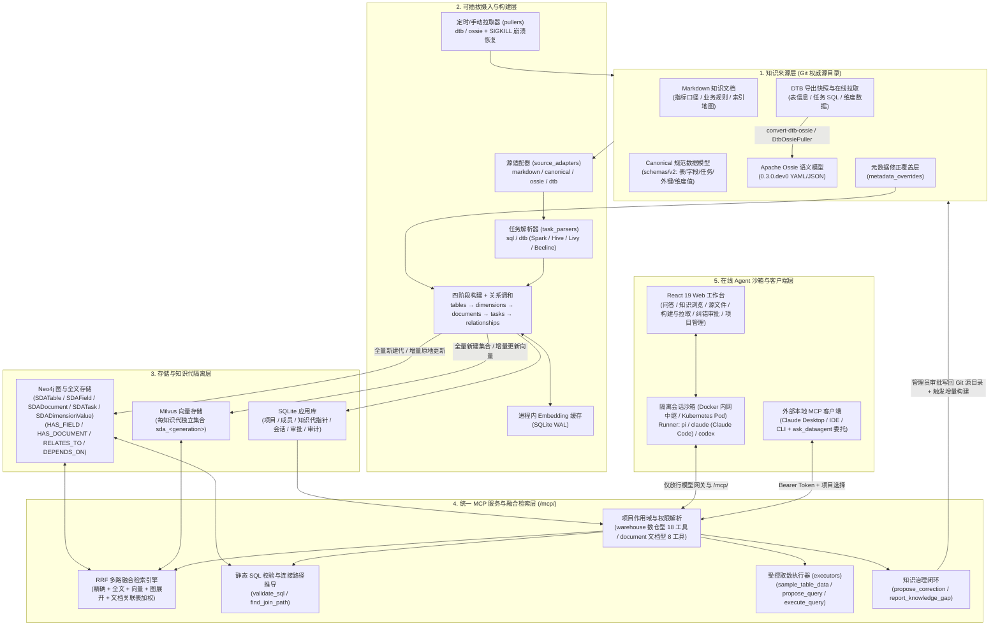

# Semantica DataAgent

基于 [Semantica](https://pypi.org/project/semantica/) 构建的企业级智能**知识问答（Knowledge Q&A）**与受控**取数（Data Retrieval）**系统。

系统将分散的**数仓元数据**（表结构、数仓任务 SQL、上游依赖、字段血缘、外键关系）、维度表的真实**维度值**以及业务团队维护的 Markdown **知识文档**，统一构建为由 **Neo4j（结构、关系与全文索引）+ Milvus（稠密向量）** 驱动的多代知识库；对外通过自建的 **Streamable HTTP MCP 服务（`/mcp/`）** 与 **Web 在线多 Agent 沙箱工作台**，提供有证据引用的口径解答、多跳连接路径推导、静态 SQL 校验、模糊时主动**澄清（Clarification）**、两阶段安全取数以及经审批写回源目录的知识纠错演进闭环。

---

## 整体系统架构



---

## 六大核心子系统详解

### 1. 多项目隔离与双项目类型体系

- **项目（Project）与类型边界**：
  - 每个项目是独立的知识库实例，拥有独立的**源目录**、构建队列、**知识代**、插件配置、成员权限與纠错审批，项目之间互不可见、不做跨项目检索。
  - **数仓型项目（`warehouse`）**：面向数仓知识问答与取数，支持表、字段、任务、上游依赖、外键关系、维度值与知识文档，开放全部 18 个 MCP 工具，注入 `skills/dataagent-retrieval` 检索技能。默认项目 `default`（“业务数据”）为数仓型。
  - **文档型项目（`document`）**：面向平台架构、规范制度等纯文档知识库，仅运行支持 `document` 的源适配器（如 `markdown`），仅开放 8 个文档与治理类 MCP 工具，注入 `skills/dataagent-document-retrieval` 检索技能，从根源屏蔽 SQL 与取数入口。
- **存储命名与生命周期管理**：
  - 项目 ID（`[a-z][a-z0-9]{0,23}`）作为知识代前缀（`<project_id>_`），Neo4j 节点按 `generation` 属性隔离，Milvus 按 `sda_<generation>` 集合隔离。
  - 支持项目 `active`（正常）、`archived`（归档冻结：保留全部数据与会话查看权限，但提问、上传、拉取、构建、下载链接与 MCP 访问统一返回 `409 项目已归档`）以及 `deleting`（按 `source → neo4j → milvus → attachments → database` 五步持久化推进的可恢复永久删除）。
  - 所有项目创建、改名、成员角色变更、归档、恢复与删除操作均记录至不可篡改的 `project_audit` 审计表。

### 2. 可插拔摄入、规范数据模型与无锁知识代构建

系统通过 Python Entry Points 提供五大类插件扩展（详见 [docs/plugins.md](docs/plugins.md)）：

| 插件组（Entry Point） | 内置实现 | 职责说明 |
| --- | --- | --- |
| `semantica_dataagent.source_adapters` | `canonical`、`markdown`、`ossie`、`dtb` | 将源目录中的不同格式文件读取并转换为统一的**规范数据模型（Canonical Model）**记录与源文件哈希 |
| `semantica_dataagent.task_parsers` | `sql`、`dtb` | 解析 `spark`、`hive`、`doris` 及 `shell`（Livy `submit_sql_and_wait`、`beeline -e`、变量展开、`merge_onself`）任务 SQL，提取表级**上游依赖**与字段血缘 |
| `semantica_dataagent.pullers` | `dtb`、`ossie` | 定时或手动从远程 DTB 服务拉取数仓元数据、任务与维度表，原子发布至项目源目录并入队构建 |
| `semantica_dataagent.executors` | `dtb` | 执行受控表数据取样（`sample_table_data`）与经用户确认后的取数查询（`execute_query`） |
| `semantica_dataagent.agent_runners` | `pi`、`claude`、`codex` | 在隔离容器或 Kubernetes Pod 中驱动不同 CLI Agent 进行多轮工具调用与流式回答 |

- **规范数据模型（`schemas/v2`）**：所有外部来源在构建时统一归一化为 8 类实体/关系——表（`table`，含可选 `catalog`）、字段（`field`）、数仓任务（`task`）、上游依赖、字段血缘、显式**外键关系**（`relationship`）、**维度值**（`dimension_value`）与**知识文档**（`document`）。
- **四阶段构建与关系调和**：
  1. `table_stage`：合并元数据**修正覆盖层（Metadata Override）**，写入 `SDATable` / `SDAField` 图节点、`HAS_FIELD` 边以及表/字段向量。
  2. `dimension_stage`：按去重原值写入 `SDADimensionValue` 节点（Neo4j `cjk` 中文分词全文索引，不占向量集合），并对同表同 `row_id` 的 `<前缀>_code` / `<前缀>_id` / `<前缀>_type` 与 `<前缀>_name` 建立双向别名映射。
  3. `document_stage`：按标题与段落切分 Markdown 文档（超长段落二次切分），自动生成缺失的一级目录 `index.md` **索引地图**，写入 `SDACategory` / `SDADocument` 节点与切片向量。
  4. `task_stage` 与 `relationships`：运行任务解析器写入 `SDATask`、表级 `DEPENDS_ON` 上游依赖边、字段级血缘、显式外键 `RELATES_TO` 边，以及文档正文提及或字典文件名匹配的 `HAS_DOCUMENT` 表-文档关联边。
- **知识代（Knowledge Generation）与增量构建**：
  - **全量构建（`full`）**：写入全新的知识代与 Milvus 集合，全部阶段成功后通过单行 `generation_pointer` 原子切换当前代指针，默认保留最近 2 代，支持一键回滚切换，重建期间在线问答零停服（[ADR 0003](docs/adr/0003-knowledge-generations.md)）。
  - **增量构建（`incremental`）**：对比同一知识代上次成功构建的源文件哈希，仅清理并重写新增、修改或删除文件波及的图节点、关系边与向量；失败构建记录待修复来源，下次增量自动补偿清理。
  - **Embedding 缓存**：按 `(embedding_model, 维度, SHA-256(文本))` 在本地 SQLite WAL（`embedding-cache.sqlite`）缓存向量，大幅加速重复构建并节省 Embedding 调用。
  - **源目录上传与去抖自动构建**：支持单文件、文件夹与 ZIP 上传（含 `preview` 差异预览、补充模式与按知识类替换模式）；上传提交 Git 后按 `auto_build_debounce_seconds`（默认 30 秒）去抖合并触发构建。

### 3. Neo4j + Milvus 存储边界与多路融合检索

- **双存储无跨库事务设计（[ADR 0002](docs/adr/0002-neo4j-plus-milvus-without-cross-store-release.md)）**：摒弃沉重的 RDF/SPARQL 与三库分布式事务，Neo4j 存图结构、关系与全文索引，Milvus 仅存稠密向量，以确定性实体 ID 关联；单次 `search_knowledge` 控制在 5 次存储往返以内。
- **RRF 倒数排名融合检索（[docs/fusion-search.md](docs/fusion-search.md)）**：
  - 综合**精确匹配（权重 2.0）**、**全文检索（权重 1.0）**、**向量语义检索（权重 1.0）**与**一跳图展开（权重 0.5）**计算倒数排名融合分（`k=60`），自动标注高/中/低置信度。
  - **表与知识文档联合融合**：检索表时同步检索知识文档，将命中文档通过 `HAS_DOCUMENT` 关联的物理表（图关联权重 1.5）纳入融合排序，使业务口径文档中提到的核心表能被精准召回。
  - **歧义检测**：当两个及以上不同文档的召回段落同时命中查询词时，自动标记“可能歧义”并附带段落引用，驱动 Agent 核对原文或向用户发起**澄清**。
- **连接路径查找与静态 SQL 校验**：
  - `find_join_path`：在当前知识代图上搜索表间最短路径，区分显式外键 `RELATES_TO`（`strength="strong"`）与任务共现/血缘推断连接，输出可直接用于 JOIN 的列配对建议。
  - `validate_sql`：基于 `sqlglot` AST 对候选 SQL 进行静态全面体检——核验三段式 `catalog.database.table` 与物理列存在性、拒绝跨多目录同名表歧义、检查大表分区列（`partition=true`）过滤条件与 `MAX(dt)` 最新分区子查询同目录限定，并核对多表 `JOIN ... ON` 是否具备外键或已知连接证据。

### 4. 自建 Streamable HTTP MCP 服务与 18 个工具矩阵

系统不依赖仅支持本地 stdio 与内存存储的 `semantica-mcp`，而是在 FastAPI 上自建带认证、项目作用域隔离与审计的 Streamable HTTP MCP 服务（`/mcp/`，见 [ADR 0001](docs/adr/0001-own-mcp-server-over-semantica-mcp.md)）。所有工具均支持 `cursor` 分页与超大字段 `result_fragment` 分片传输：

| 分类 | 工具名 | 适用项目类型 | 功能说明 |
| --- | --- | --- | --- |
| **能力与路由** | `get_capabilities` | `warehouse` / `document` | 返回当前解析到的项目信息、可访问项目列表与当前项目类型可用工具集 |
| **文档与目录** | `list_categories` | `warehouse` / `document` | 列出知识库中的一级**知识类**目录及文档统计 |
| | `read_category_index` | `warehouse` / `document` | 读取指定知识类的 `index.md` **索引地图**（仅用于定位文档，不直接作为答案依据） |
| | `read_document` | `warehouse` / `document` | 读取指定知识文档全文或章节内容 |
| **融合检索** | `search_knowledge` | `warehouse` / `document` | 多路融合检索知识文档、表、字段与数仓任务，返回置信度与歧义提示 |
| **数仓元数据与血缘** | `describe_tables` | `warehouse` | 查看单表或多表的完整字段定义、分区键、注释及关联文档引用（支持三段式限定） |
| | `lookup_dim_values` | `warehouse` | 在 Neo4j `cjk` 索引中检索维度表真实**维度值**及同行编码↔名称配对 |
| | `get_lineage` | `warehouse` | 查询表或任务的上下游依赖图（`DEPENDS_ON`）与字段级血缘 |
| | `read_task_sql` | `warehouse` | 读取产出或消费指定表的数仓任务原始 SQL 与调度配置 |
| **SQL 推导与校验** | `find_join_path` | `warehouse` | 查找多张物理表之间的外键（`RELATES_TO`）或任务血缘连接路径 |
| | `validate_sql` | `warehouse` | 静态校验 SQL 语法、表/字段存在性、Catalog 限定、分区裁剪与 JOIN 合理性 |
| **受控取样与取数** | `sample_table_data` | `warehouse` | 对目标表执行受控小样本探查，辅助确认字段实际格式 |
| | `propose_query` | `warehouse` | 生成待用户确认的结构化查询计划（先校验 SQL 与分区约束，不直接查库） |
| | `execute_query` | `warehouse` | 执行已确认的查询计划并返回结果摘要与短期签名下载链接 |
| **交互与治理** | `request_clarification` | `warehouse` / `document` | 证据不足或存在多口径变体时，向提问者发起带证据依据的结构化**澄清**选项 |
| | `propose_correction` | `warehouse` / `document` | 提交文档或表/字段元数据的**纠错提案**（含修改前后对比与理由），进入管理员审批队列 |
| | `report_knowledge_gap` | `warehouse` / `document` | 上报当前知识库无法回答的**知识缺口**，供团队补充文档或元数据 |
| **跨端委托** | `ask_dataagent` | `warehouse` | 供外部本地 MCP 客户端将完整自然语言问题委托给服务端在线 Agent 执行并返回回答、SQL 与引用 |

### 5. 在线 Agent 容器/Pod 沙箱工作台与安全取数

- **隔离代替调用预算（[ADR 0005](docs/adr/0005-agent-isolation-instead-of-budgets.md)）**：
  - 在线 Agent 不设工具调用次数与硬性步骤预算，保持完整的自主探索能力；安全边界由容器/Pod 级隔离保障。
  - **Docker 模式**：每个会话运行在独立的 `semantica-dataagent-agent-runner` 容器中，仅连接内部网络；专用中继仅转发至当前会话配置的模型网关与本机 `/mcp/`，无法访问宿主机文件、源目录或其它网络目标。
  - **Kubernetes 模式（`DATAAGENT_AGENT_MODE=k8s`）**：在独立命名空间拉起会话 Pod，由 init 容器配置 iptables 白名单，支持 `DATAAGENT_SESSION_NODES` 节点池亲和调度，且不挂载任何 K8s ServiceAccount Token。
- **多 Runner、多模型能力探测与多模态附件**：
  - 支持在同一对话中跨轮次切换允许的 Provider / Model 及五档思考强度（`low` / `medium` / `high` / `extra` / `max`），自动映射为 Pi `--thinking`、Claude Code `--effort` 与 Codex `model_reasoning_effort`。
  - 管理员可在界面一键探测模型真实能力（并发红/蓝双图 Vision 识别探测 + 五档思考强度参数兼容性探测）。
  - 支持上传任意文件与图片附件（单文件 `<= 20MB`、单次最多 10 个、合计 `<= 50MB`），存储在会话专属工作区 `work/attachments`（`0600` 权限 + `O_NOFOLLOW` 防符号链接穿越），并在提示词中将附件内容严格标记为不可信数据以防提示词注入。
- **两阶段取数与下载链接安全复核**：
  - Agent 只能先调用 `propose_query` 生成查询计划；必须由提问者确认后才可执行。
  - 执行确认、直接下载与短期签名下载链接（`/download-link/...`，30 分钟有效）在每次访问时均按计划自身的 `plan_data.project_id` 实时复核令牌有效性、项目成员资格与项目未归档状态，所有越权或撤销令牌请求均记录 `rejected_401` / `rejected_404` / `rejected_409` 审计。
- **隐私安全的 Langfuse 观测**：默认仅上报工具名、耗时、状态、表名（仅从可信工具参数或 SQL AST 提取）与去字面量 SQL 指纹；仅当管理员显式开启 `langfuse_capture_content` 时才采集问答正文，且全路径强制过滤 API Key、Token 与密码。

### 6. 知识治理闭环与 Apache Ossie / DTB 语义层互操作

- **提案审批与修正覆盖层（[ADR 0004](docs/adr/0004-corrections-via-approved-proposals.md)）**：
  - 文档纠错经管理员在前端审批通过后，自动以申请人身份写回项目 Git 源目录并触发增量构建。
  - 表与字段说明纠错写入项目级 `metadata_overrides` 表，每次构建时叠加在导出数据之上，确保人工修正永远不会被下一次 DTB 定时拉取覆盖。
- **Apache Ossie（`0.3.0.dev0`）双向互操作（[ADR 0007](docs/adr/0007-ossie-semantic-interchange.md)）**：
  - `ossie` 源适配器支持导入 Apache Ossie YAML/JSON 模型（兼容 `0.1`/`0.2` 归一化并通过内置官方 `schemas/ossie/ossie-schema.json` 校验），自动完成“物理表与单列映射 → 图节点、逻辑外键 → `RELATES_TO` 边、计算字段/指标/AI 上下文 → 受保护派生文档”三路分流。
  - 支持通过 CLI `export-ossie` 或 `GET /api/v1/projects/{id}/export/ossie` 将当前知识代确定性导出为标准 Ossie 模型（通过 `nonportable_extensions` 无损保留 `partition` 与 `raw_type`）。
- **DTB → Apache Ossie 全自动提炼与混合维度落盘（[ADR 0008](docs/adr/0008-dtb-to-ossie-pipeline.md)）**：
  - 既可通过 CLI `convert-dtb-ossie` 离线转换，也可在项目配置中启用 `DTB 拉取为 Ossie`（`DtbOssiePuller`）定时拉取。
  - 保守确定性解析任务 SQL 中的物理表等值 JOIN 生成 `relationships`、一致性 `GROUP BY` / `ROW_NUMBER() = 1` 生成 `primary_key`、分区策略与直接上游写入 `dataset.ai_context.instructions`；低基数维度值原样内联进字段说明，高基数维度表保留同行 `row_id` 自动导出至 `dimension_values.json`。

---

## 目录结构

```text
Semantica_DataAgent/
├── backend/                  # Python 3.12 后端（FastAPI + SQLAlchemy + Alembic + Semantica + MCP）
│   ├── alembic/              # SQLite 数据库迁移脚本（幂等升级 + 自动备份）
│   ├── src/semantica_dataagent/
│   │   ├── app.py            # FastAPI 路由、插件配置、构建/拉取/纠错/会话入口
│   │   ├── cli.py            # semantica-dataagent CLI（init/migrate/serve/eval*/export-ossie/convert-dtb-ossie）
│   │   ├── knowledge.py      # 全量/增量知识构建编排、记录校验与知识代切换
│   │   ├── search.py         # RRF 多路融合检索、置信度计算与文档歧义检测
│   │   ├── sql_validation.py # 基于 sqlglot 的静态 SQL 校验、Catalog 限定与分区检查
│   │   ├── join_path.py      # 表间外键与血缘连接路径查找 (find_join_path)
│   │   ├── mcp_server.py     # Streamable HTTP MCP 服务端與 18 个工具实现
│   │   ├── project_api.py    # 多项目生命周期、成员权限、源适配器配置与项目审计
│   │   ├── project_types.py  # 项目类型（warehouse / document）工具与适配器权威映射表
│   │   ├── ossie_source.py   # Apache Ossie 源适配器（三路分流）
│   │   ├── ossie_export.py   # 知识代到 Apache Ossie 确定性导出
│   │   ├── dtb_ossie.py      # DTB → Ossie 确定性转换器与 DtbOssiePuller 拉取器
│   │   ├── dtb_source.py     # DTB 快照源适配器
│   │   ├── dtb_tasks.py      # DTB 任务 SQL 解析与 Shell (Livy/Beeline) 展开
│   │   ├── dtb_executor.py   # DTB 查询取样与受控取数执行器
│   │   ├── pull_service.py   # 定时/手动拉取编排与构建入队
│   │   ├── source_directory.py # Git 源目录上传、预览、原子发布与 SIGKILL 崩溃恢复
│   │   ├── pi_runner.py / claude_runner.py / codex_runner.py # 三大在线 Agent Runner
│   │   └── *_stage.py        # 独立构建写入阶段（table / dimension / document / task / relationships）
│   └── tests/                # 后端单元、崩溃恢复、Fork 安全、时间契约与端到端测试套件
├── web/                      # React 19 + TypeScript + Ant Design 6 + Vite 8 前端工作台
│   ├── contract/openapi.json # 后端 OpenAPI 契约快照（由 check:types 守护零漂移）
│   └── src/                  # 问答工作台、知识浏览、源文件管理、构建与拉取、纠错审批、项目管理与平台设置
├── schemas/                  # JSON Schema 定义
│   ├── v1/ & v2/             # 规范数据模型 Schema（table/field/task/relationship/dimension_value）
│   └── ossie/                # 官方 Apache Ossie 0.3.0.dev0 JSON Schema
├── skills/                   # 在线 Agent 检索技能（dataagent-retrieval 数仓版 / dataagent-document-retrieval 文档版）
├── deploy/                   # Kubernetes 部署清单、应用 Dockerfile 与 agent-runner 沙箱镜像
├── eval/                     # 评测题集与评测配置样例
├── scripts/                  # 真实样本抽取 (dtb_sample.py)、血缘对比与样本构建验证脚本
├── docs/                     # 架构决策记录（ADR 0001–0008）、代码规范、插件、融合检索与评测文档
└── GLOSSARY.md               # 项目统一领域术语表
```

---

## 环境要求

- **后端**：Python `3.12.x`、[`uv`](https://docs.astral.sh/uv/)、`git`
- **前端**：Node.js `24.x`（兼容 `22.x`）、`pnpm` `10.x`
- **外部存储与运行环境**：
  - **SQLite**：本地应用状态库与 Embedding 缓存（内置）
  - **Neo4j `5.28+`**：知识图与全文索引存储（构建与检索必需）
  - **Milvus `2.5+`**：向量检索存储（构建与检索必需）
  - **OpenAI 兼容 Embedding 服务**：如 Infinity 部署的 `model/bge-m3`（1024 维）或 `model/bge-small-zh-v1.5`（512 维）
  - **在线 Agent 沙箱**：默认使用 Docker（镜像 `semantica-dataagent-agent-runner:1.2.0`）或 Kubernetes（`DATAAGENT_AGENT_MODE=k8s`）；本地可信开发调试可设置 `DATAAGENT_AGENT_MODE=local`

---

## 快速开始

### 1. 安装前后端依赖

```bash
# 安装后端 Python 依赖
uv sync --directory backend --locked

# 安装前端依赖
pnpm --dir web install --frozen-lockfile
```

### 2. 初始化数据库与系统管理员令牌

```bash
export DATAAGENT_DB_PATH="$PWD/data/app.db"
export DATAAGENT_ENCRYPTION_KEY="$(uv run --directory backend python -c 'from cryptography.fernet import Fernet; print(Fernet.generate_key().decode())')"

# 初始化 SQLite 数据库并输出初始管理员 Token（仅显示一次，请妥善保存）
uv run --directory backend semantica-dataagent init
```

### 3. 启动服务

```bash
# 终端 1：启动后端 REST 与 MCP 服务（默认监听 127.0.0.1:8000）
# 如在本地免 Docker 调试在线问答，可加上 DATAAGENT_AGENT_MODE=local
DATAAGENT_AGENT_MODE=local uv run --directory backend semantica-dataagent serve

# 终端 2：启动前端开发服务器
pnpm --dir web dev
```

使用管理员令牌登录前端后：
1. 在 **配置 → 平台设置** 中配置 Neo4j、Milvus、Embedding 服务地址、源目录（`source_directory`）以及在线 Agent Provider（Anthropic / OpenAI / Google 等）与模型。
2. 在 **项目管理** 中为项目启用所需的**源适配器**（默认启用 `Canonical` + `Markdown`，可按需启用 `Apache Ossie` 或 `DTB`）及定时拉取配置。
3. 在 **源文件** 页上传知识文档或模型文件，或在 **构建** 页触发拉取与知识库构建，即可在 **问答** 工作台或通过 `/mcp/` 发起提问。

---

## CLI 命令参考

所有命令均通过 `uv run --directory backend semantica-dataagent <command>` 执行：

| 子命令 | 用途说明 |
| --- | --- |
| `init` | 初始化 SQLite 数据库并生成一次性系统管理员令牌 |
| `migrate` | 将数据库升级至最新 Alembic head（版本落后时自动备份原 SQLite 文件） |
| `serve` | 启动 FastAPI REST API 与 `/mcp/` Streamable HTTP 服务 |
| `eval` | 运行 YAML 评测题集（支持纯检索评测模式与 `--agent pi` 在线问答评测模式），输出 `.md` 与 `.json` 报告 |
| `eval-exec` | 针对在线 Agent（`pi` / `claude` / `codex`）运行端到端取数执行评测，对比参考 SQL 结果集 |
| `eval-split` | 按分层抽样生成可复现的 `dev` / `holdout` 评测题集切分 |
| `eval-report` | 将经人工核实的失败归因合并至 `eval-exec` 评测报告 |
| `export-ossie` | 将指定项目当前知识代导出为 Apache Ossie（YAML / JSON）语义模型文件 |
| `convert-dtb-ossie` | 将本地 DTB 导出快照与维度表离线确定性转换为 Apache Ossie 模型与高基数 `dimension_values.json` |

---

## 开发与验证常用命令

```bash
# 1. 后端代码格式与静态检查
uv run --directory backend ruff format --check src tests
uv run --directory backend ruff check src tests

# 2. 后端单元与集成测试（本地模式）
DATAAGENT_AGENT_MODE=local uv run --directory backend pytest

# 3. 仓库级守护测试（AGENTS.md 体积 <= 16KB、data/ gitignore 保护、Dockerfile 技能与 Schema 拷贝）
uv run --directory backend pytest ../tests/test_agents_size.py ../tests/test_data_ignore.py ../tests/test_docker_skills_copy.py

# 4. 前后端 OpenAPI 契约与 TypeScript 类型同步及零漂移检查
uv run --directory backend python -m semantica_dataagent.openapi > web/contract/openapi.json
pnpm --dir web types
pnpm --dir web check:types

# 5. 前端代码格式、单元测试与生产构建
pnpm --dir web format:check
pnpm --dir web test
pnpm --dir web build
```

---

## 核心文档与架构决策（ADR）索引

- **领域语言与规范**
  - [GLOSSARY.md](GLOSSARY.md) — 统一领域术语表（中英文对照与禁用词约束）
  - [docs/code-standards.md](docs/code-standards.md) — 项目工程与代码规范全集
  - [LESSONS.md](LESSONS.md) — 历史故障复盘与工程防呆教训
- **子系统设计文档**
  - [docs/plugins.md](docs/plugins.md) — 源适配器、任务解析器、拉取器与构建阶段规范
  - [docs/fusion-search.md](docs/fusion-search.md) — RRF 融合检索权重、歧义判定与 MCP 分页/错误约定
  - [docs/dimension-values.md](docs/dimension-values.md) — 维度值 Neo4j `cjk` 索引与同行编码配对规则
  - [docs/evaluation.md](docs/evaluation.md) — 检索与端到端取数评测体系说明
  - [docs/infrastructure.md](docs/infrastructure.md) — Kubernetes 集群、测试命名空间与存储部署说明
  - [docs/agents/adding-an-agent.md](docs/agents/adding-an-agent.md) — 新增在线 Agent Runner 插件指南
- **架构决策记录（ADR）**
  - [ADR 0001 — 自建 HTTP MCP，不使用 semantica-mcp](docs/adr/0001-own-mcp-server-over-semantica-mcp.md)
  - [ADR 0002 — 存储用 Neo4j + Milvus，两者之间不做跨库发布](docs/adr/0002-neo4j-plus-milvus-without-cross-store-release.md)
  - [ADR 0003 — 用知识代实现全量重建期间的不停服与回滚](docs/adr/0003-knowledge-generations.md)
  - [ADR 0004 — 知识纠错走提案审批，写回源目录](docs/adr/0004-corrections-via-approved-proposals.md)
  - [ADR 0005 — 在线 Agent 用容器隔离保证安全，不设调用预算](docs/adr/0005-agent-isolation-instead-of-budgets.md)
  - [ADR 0006 — 可插拔数据摄入架构](docs/adr/0006-pluggable-ingestion-for-open-source.md)
  - [ADR 0007 — Apache Ossie 作为语义模型双向交换标准](docs/adr/0007-ossie-semantic-interchange.md)
  - [ADR 0008 — DTB 元数据与任务 SQL 自动转换为 Apache Ossie 与混合维度落盘](docs/adr/0008-dtb-to-ossie-pipeline.md)

## 许可证

本项目基于 [LICENSE](LICENSE) 开源许可发布。
